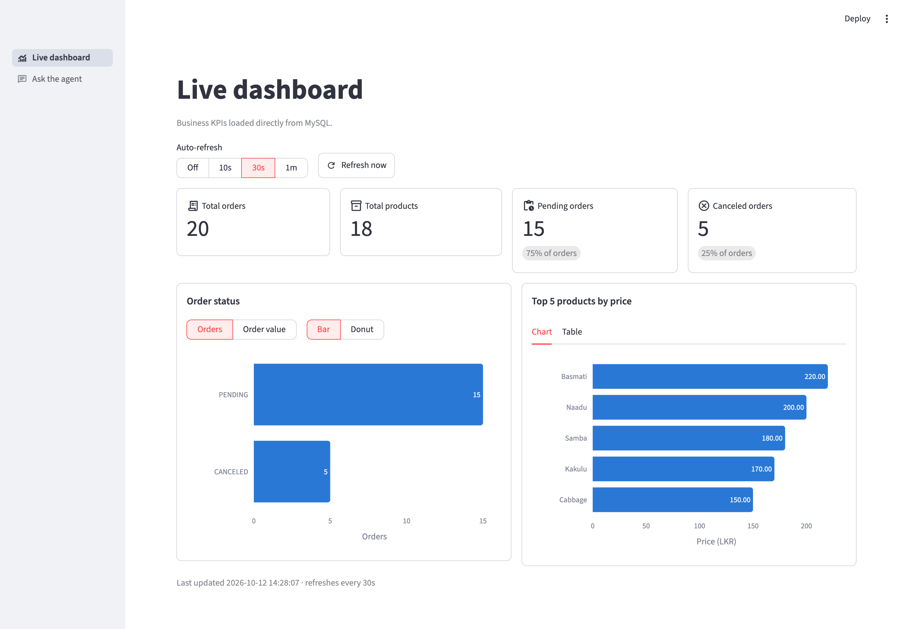
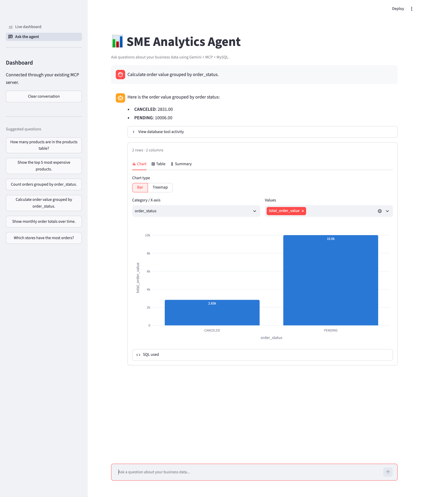
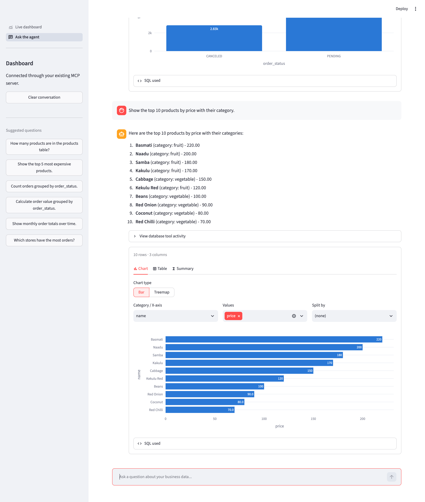
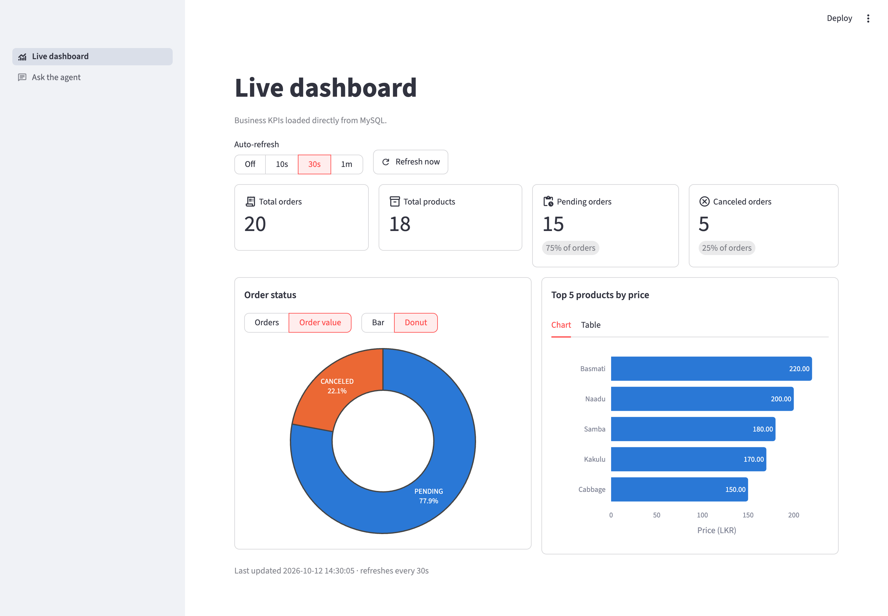

# SME Analytics Agent

Ask questions about your business data in plain English and get answers back as text, interactive charts and tables. The app also has a live KPI dashboard.

The app connects **Google Gemini** to a **MySQL** database through an **MCP (Model Context Protocol)** server. Gemini decides which database tools to call, and the MCP server runs only safe, read-only SQL.



---

## Features

### Ask the agent (chat)
- Ask questions in natural language, for example *"Calculate order value grouped by order_status"*.
- Gemini writes the SQL and runs it through the MCP tools. It answers only from real query results.
- **Interactive results** for every query:
  - **Chart picked automatically from the data:**
    - date or month column → line chart
    - 3–6 categories → pie chart
    - more categories → bar chart (horizontal bars for long labels)
    - several number columns → grouped bars or scatter plot
    - one row → headline number cards
  - You can switch chart type and choose the X-axis, values and "Split by" column.
  - **Table** tab with CSV download, and **Summary** tab with statistics.
  - **SQL used** section, so every answer can be checked.
- Conversation memory for follow-up questions, plus suggested questions in the sidebar.

| Order value by status | Top products by price |
|---|---|
|  |  |

### Live dashboard
- KPI cards: **total orders**, **total products**, **pending orders** and **canceled orders**, with each status's share of all orders.
- **Order status** chart: switch between order count and order value, shown as a bar or donut chart.
- **Top 5 products by price**, as a chart or a table.
- **Live updates:** auto-refresh every 10s, 30s or 1 minute (or off), plus a *Refresh now* button. Only the data area reloads, not the whole page.
- All numbers come straight from MySQL; nothing is hardcoded.



### SQL safety
The `query_database` MCP tool:
- accepts only **one `SELECT` statement** (parsed with `sqlglot`, MySQL dialect)
- rejects comments, multiple statements and `SELECT … INTO`
- caps results at **1000 rows**

---

## Architecture

```
┌──────────────────────┐      ┌────────────────┐
│  Streamlit web UI    │      │  Google Gemini │
│  app/web_ui.py       │◀────▶│  (tool calls)  │
│  ├─ Live dashboard ──┼──┐   └────────────────┘
│  └─ Ask the agent    │  │           │
└──────────┬───────────┘  │           │ function calls
           │ agent_service│           ▼
           │              │   ┌────────────────┐
           └──────────────┼──▶│  MCP server    │  stdio
                          │   │  app/server.py │
                          │   └───────┬────────┘
                          │           │ read-only SQL
                          ▼           ▼
                       ┌──────────────────┐
                       │      MySQL       │
                       └──────────────────┘
```

The dashboard reads KPIs directly from MySQL. The chat goes through Gemini and the MCP server.

### Project structure

```
app/
├── web_ui.py            # Streamlit entry point (page navigation)
├── app_pages/
│   ├── dashboard.py     # Live KPI dashboard
│   └── chat.py          # Chat with the agent
├── agent_service.py     # Gemini ⇄ MCP tool-calling loop used by the web UI
├── result_viz.py        # Parses query results, picks charts, renders table/chart/summary
├── dashboard_data.py    # KPI and chart queries for the dashboard
├── server.py            # MCP server: list_tables, describe_table, query_database
├── db.py                # Shared MySQL connection
└── gemini_agent.py      # Command-line version of the agent
docs/screenshots/        # README images
test_db.py               # Checks the MySQL connection
test_gemini.py           # Checks the Gemini API key
```

---

## Getting started

### 1. Prerequisites
- Python **3.12+**
- A MySQL database
- A [Google Gemini API key](https://aistudio.google.com/app/apikey)

### 2. Install

```bash
git clone https://github.com/amalskr/MCPAgent.git
cd MCPAgent
python -m venv .venv
source .venv/bin/activate        # Windows: .venv\Scripts\activate
pip install -r requirements.txt
```

### 3. Configure

Create a `.env` file in the project root. It's already in `.gitignore`, so it won't be committed.

```env
MYSQL_HOST=localhost
MYSQL_PORT=3306
MYSQL_DATABASE=your_database
MYSQL_USER=your_user
MYSQL_PASSWORD=your_password
GEMINI_API_KEY=your_gemini_api_key
```

> Use a MySQL user with **read-only** (`SELECT`) permissions. This adds a second layer of protection on top of the server's SQL checks.

### 4. Check connections (optional)

```bash
python test_db.py
python test_gemini.py
```

### 5. Run the web app

```bash
streamlit run app/web_ui.py
```

Open http://localhost:8501. The **Live dashboard** opens first; use **Ask the agent** in the sidebar to chat.

You don't need to start the MCP server yourself. The chat starts it as a subprocess (`python -m app.server`) for each question.

### Other ways to run it

```bash
# Command-line chat agent
python -m app.gemini_agent

# MCP server on its own (stdio), e.g. to connect another MCP client
python -m app.server
```

---

## Dashboard data

The dashboard expects these tables and columns:

| Widget | Source |
|---|---|
| Total / pending / canceled orders | `orders.order_status` (`PENDING`, `CANCELED`/`CANCELLED`) |
| Total products | `COUNT(*)` on `products` |
| Order value | `orders.full_amount` (converted to a number) |
| Top 5 products by price | `products.name`, `category`, `price_lkr`, `quantity` |

To change or add KPIs, edit the SQL in `app/dashboard_data.py`. Results are cached for 5 seconds, so many viewers don't overload the database.

---

## Tech stack

[Streamlit](https://streamlit.io) · [Plotly](https://plotly.com/python/) · [pandas](https://pandas.pydata.org) · [Google Gen AI SDK](https://github.com/googleapis/python-genai) (`gemini-2.5-flash`) · [MCP Python SDK](https://github.com/modelcontextprotocol/python-sdk) · [sqlglot](https://github.com/tobymao/sqlglot) · [MySQL Connector/Python](https://dev.mysql.com/doc/connector-python/en/)
